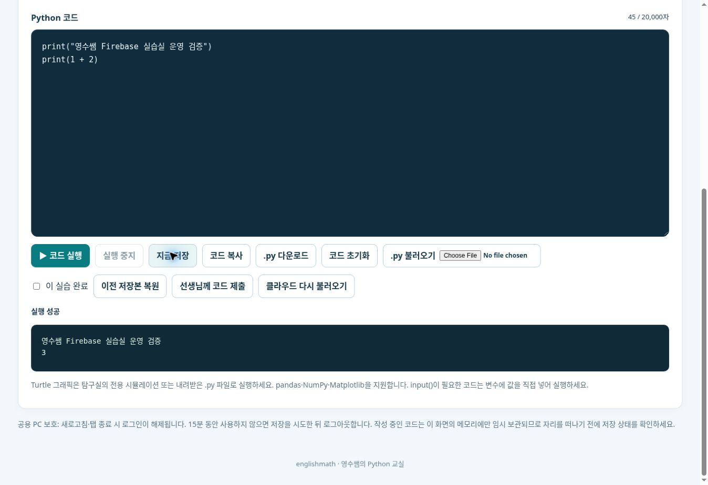

# 학생 개인 학습실 V1 — 운영 및 검증 기록

기준일: 2026-11-04 (한국 시각). 원본 수업 저장소는 `englishmath75/pico-lab-classroom`, 공식 도메인 게시자는 `englishmath75/sw`입니다. 기존 수업 목차와 탐구실 A~D 제목은 유지합니다.

## Firebase 실사

| 관리 계정 | 확인된 결과 |
| --- | --- |
| englishmath@muhak-g-h.gne.go.kr | 실제 재인증 후 Console 접근. 아래 기존 3개 프로젝트 접근 및 소유자 권한 확인 |
| englishmath6003@gmail.com | 실제 로그인 확인. 현재 프로젝트 목록 없음. somni-school 설정 접근 권한 없음 |

| 기존 프로젝트 ID | 웹앱 | 인증 | Firestore | 요금제 |
| --- | --- | --- | --- | --- |
| muhak-school-alimi | 학교알리미 웹 | Google 활성화 | 기존 DB, asia-northeast3 | Spark |
| somni-school | somni-web | Google 및 이메일/비밀번호 활성화 | 기존 DB, asia-northeast3 | Spark |
| ebs-vocabulary-ranking | ebs-vocabulary-web | 익명 활성화, Google 미활성화 | 기존 DB, asia-northeast3 | Spark |

알리미 OAuth 허용 도메인에는 해당 Firebase 기본 도메인, localhost, 기존 Vercel 운영·미리보기 도메인이 있습니다. Somni에는 localhost와 기본 firebaseapp.com/web.app 도메인이 확인되었습니다. 연결된 GitHub 저장소 목록과 Somni 코드 검색에서 Somni 저장소는 확인되지 않았습니다. Firebase의 실제 프로젝트 식별과 저장소 식별은 구분합니다.

기존 프로젝트를 재사용하면 인증·읽기/쓰기 할당량·규칙을 다른 서비스와 공유합니다. 이번 기능은 전용 **englishmath-python-classroom** 프로젝트로 분리했습니다. 학교 계정이 관리하며, Spark 무료 요금제를 유지합니다. 웹앱 닉네임은 `영수쌤의 Python 교실 웹`, Firestore `(default)` 리전은 **asia-northeast3 (Seoul)**입니다. Gemini, Analytics, 유료 예약 백업은 켜지 않았습니다. 기존 3개 프로젝트의 데이터와 규칙은 수정하지 않았습니다.

EBS 프로젝트의 승인 도메인은 localhost, ebs-vocabulary-ranking.firebaseapp.com, ebs-vocabulary-ranking.web.app, rnlrk-wlq.github.io입니다. 기존 서비스의 설정은 읽기만 했습니다.

새 OAuth 앱에서 학교 교사 계정과 별도 허용 Gmail 계정의 실제 로그인이 모두 성공했습니다. 학교 교사 계정의 현재 정책에서 동작한다는 증거이며, Google Workspace 관리 콘솔의 학생 OU별 외부 앱 정책까지 확인한 것은 아닙니다. 실제 학생 계정 정책과 학교·가정의 물리적 PC 검증은 별도 확인 대상입니다.

## 데이터와 권한

- `users/{uid}`: Google 이메일, 표시 이름, 학급 ID, 승인 상태, 생성/변경 시각. 가입은 허용 도메인/명시적 이메일의 Google 인증만 허용하고 항상 pending으로 시작합니다.
- `users/{uid}/workspaces/{id}`: 현재 코드와 제목, 차시, 마지막 실행 상태, 학생이 표시한 완료 여부, 저장 시각, 충돌 방지 버전.
- `users/{uid}/revisions/{id}__{slot}`: 최근 10개 저장본을 고정 슬롯에 순환 보관합니다.
- `users/{uid}/progress/{id}`: 코드 본문이 없는 학습 진행 정보. 승인된 담당 학급 교사만 조회합니다.
- `users/{uid}/submissions/{id}`: 학생이 명시적으로 제출한 코드. 자동 저장본과 독립되어 있으며 담당 교사에게만 공개합니다.
- `users/{uid}/limits/state`: 서버 시각과 원자적 트랜잭션을 사용하는 저장·제출 제한.
- `classes/{classId}`: 학급 제목과 활성 상태.
- `staff/{uid}`: 신뢰된 Console/Admin 경로에서만 설정하는 담당 학급 목록. 이메일 도메인으로 교사 권한을 부여하지 않습니다.
- `config/access`: 허용 학교 도메인과 별도 승인 이메일. 클라이언트 쓰기는 금지합니다.

운영 규칙의 원본은 루트 `firestore.rules`입니다. 학생은 다른 UID의 초안·수정 이력·제출본을 읽을 수 없습니다. 교사도 학생의 비공개 자동 저장 코드와 수정 이력을 읽을 수 없습니다. 학생은 본인의 승인 상태·학급·staff 역할을 바꿀 수 없습니다. 비밀번호·OAuth 토큰·서비스 계정 키는 문서에 저장하지 않습니다.

## 공용 PC와 Python 격리

Firebase Authentication은 메모리 지속성, Firestore는 메모리 캐시를 사용합니다. 새로고침과 탭 종료 후에는 다시 로그인해야 합니다. 로그인 때마다 Google 계정 선택 화면을 요청합니다. 자동 로그아웃 1분 전에 저장을 시도하고 실패를 알립니다. 15분 미사용 시 다시 저장을 시도한 뒤 로그아웃하고 화면을 지웁니다. 공용 PC 다운로드 폴더에 코드가 자동으로 남지 않도록 파일은 학생이 직접 .py 다운로드를 눌렀을 때만 생성합니다. 연결이 끊겼다면 경고가 표시되는 동안 직접 파일을 내려받거나 학습을 계속해야 미저장 코드를 보존할 수 있습니다.

계정 또는 실습 변경 시 세대 번호를 바꿔 늦게 도착한 이전 읽기·저장·실행 결과를 화면에 반영하지 않습니다. 로그아웃은 같은 브라우저의 다른 수업 탭에도 전달됩니다. 기존 익명 수업 실습은 현재 탭에만 유효한 15분 임시 보관으로 바꾸며, 소유자를 알 수 없는 예전 localStorage 코드는 자동으로 불러오거나 업로드하지 않습니다.

개인 실습실은 `sandbox="allow-scripts"`의 불투명 출처 iframe 안에서 새 Worker를 만들고, 실행 후 iframe과 Worker를 폐기합니다. 코드와 가상 CSV만 전달하며 계정·토큰은 전달하지 않습니다. 실행 시간 20초, 준비 시간 120초, 출력 80,000자 제한이 있습니다. 기존 수업 실행기도 요청 완료 후 Worker를 종료합니다. Turtle은 기존 전용 시뮬레이션 또는 VS Code용 .py로 안내합니다.

## 사용량 제한

- 코드 최대 20,000자, 고정 실습 25개.
- 자동 저장은 변경 시 60초 간격. 서버 규칙은 UID당 최소 15초 간격, 하루 150회 코드 저장·제출·삭제 동작으로 제한합니다.
- 한 번의 코드 저장은 현재본·수정 이력·진도·제한 기록의 4개 쓰기입니다. 29명 각 150회 저장의 상한은 UTC 날짜 기준 17,400개 쓰기입니다. 29명이 50분 수업 동안 매분 변경·저장하면 약 5,800개 쓰기입니다. Firebase 무료 할당량 초기화 시각과 이 날짜 경계는 다르므로, 여러 날짜에 걸친 집중 사용과 가입·운영 문서까지 포함하면 무료 한도에 도달할 수 있습니다.
- 수정 이력 10개, 작업실 25개, 제출본 분리로 문서 수 증가를 제한합니다. `firestore.indexes.json`과 같이 workspaces/revisions/submissions의 code 필드에 대한 컬렉션 범위 오름차순·내림차순·배열 색인을 운영 Console에서 사용 중지했습니다. 기존 기본 컬렉션 그룹 색인 비활성 상태는 유지합니다.
- Spark에서 무료 할당량을 넘으면 기능이 제한될 수 있습니다. 자동 유료 전환이나 Blaze 연결은 하지 않습니다. 읽기 요청에 대한 전역 속도 제한은 Security Rules만으로 완전히 구현할 수 없으며, 향후 사용량에 따라 App Check 등 추가 통제를 검토해야 합니다.

공식 무료 할당량 문서: https://firebase.google.com/docs/firestore/quotas

## 검증 상태

| 검증 | 결과 | 구분 |
| --- | --- | --- |
| 권한 분리·학생 역할 위조·담당 학급 제한·교사 초안 차단·쓰기 제한·충돌·이력 | 13개 테스트 PASS | Firebase Firestore Emulator |
| 29명 동시 저장·개별 재조회·교차 UID 차단 | 각 29건 PASS | Emulator, 실제 학생 개인정보 사용 없음 |
| 가상 Google A/B 로그인·공용 PC 교체·독립 브라우저 문맥 재조회 | PASS | Auth + Firestore Emulator, Chromium |
| 실제 Pyodide 출력 1+2=3 | PASS | 샌드박스 iframe + 새 Worker |
| 오프라인 경고·초안 유지·복원·자동 저장·미사용 로그아웃·390px 화면·기존 수업 탭 분리·교사 승인·명시적 제출물 조회 | 13개 시나리오 PASS | Chromium 자동화, GitHub Actions 41758708144 |
| 기존 수업 코드·문제·자료·링크 | 50개 누적 Python 실행, 20개 문제 정의, 다운로드 검사 PASS | 기존 회귀 테스트 |
| Pages 경로 패키징 | 527개 내부 링크 및 동영상 목록 파일 PASS | 기존 sw 패키징/검사 도구 |
| 운영 Firebase Rules 게시·익명 읽기 차단 | 게시 완료, 익명 REST 요청 403 PERMISSION_DENIED | 전용 운영 프로젝트 |
| 실제 학교 Google OAuth·코드 작성·실행·수동/자동 저장 | PASS, print(1 + 2) 결과 3 | 공식 운영 도메인, 본인 교사 계정 |
| 독립 로그인 세션의 서버 저장본 재조회·재실행 | PASS | 운영 도메인 새 탭에서 메모리 인증 미승계 확인 후 실제 재로그인. 물리적 집 PC 검증과 구분 |
| 실제 본인 학교 계정 A → 로그아웃 → Gmail 계정 B | 이전 코드 제거, 같은 scratch-10에 서로 다른 코드 저장 PASS | 운영 도메인, B에는 교사 메뉴 없음. 실제 학생 개인정보를 테스트에 사용하지 않음 |
| 실제 본인 Gmail 학급 등록·교사 승인·명시적 코드 제출 | PASS | 운영 계정 두 개. 다른 학생의 승인/코드는 변경하지 않음 |
| 최신 교사 관리실의 제출 코드·진도·마지막 저장 시각 조회 | PASS | 학교 계정으로 재로그인, 일반 계정 B의 명시적 제출본 확인 |
| B에서 A로 복귀 | B의 코드가 아닌 A의 원래 코드 재조회 PASS | 동일 PC·동일 scratch-10·서로 다른 실제 Firebase UID |
| 실제 운영 세션 미사용 자동 로그아웃 | 공용 PC 보호 로그아웃 안내·개인 코드 화면 제거 확인 | 최신 배포의 실제 학교 계정 세션, 자동화 타이머 검사와 별도 |

기능 변경 PR #16·#17·#18이 기존 main 이력을 유지해 병합된 상태를 확인했습니다. 최종 보안/브라우저 검증: https://github.com/englishmath75/pico-lab-classroom/actions/runs/41758708144 . 공식 Pages 게시 성공: https://github.com/englishmath75/sw/actions/runs/41759150721 . 실제 `https://sw.englishmath.kr/site-version.json`의 원본 커밋은 `1fd8aa3bbf6cd7b0e2d7f5947a4ad2cda81bf6c2`로 확인했습니다. 문서만 추가하는 후속 커밋은 기능 소스를 바꾸지 않습니다.

운영 실행 증거(계정/학생 개인정보가 보이지 않는 화면):

## 남은 현장 확인 및 운영 범위

V1 기능과 운영 도메인의 실제 로그인·저장·독립 세션 복원·계정 전환·교사 제출물 조회는 확인했습니다. 학교 PC와 집 PC의 물리적인 두 기기에서 접속한 것은 아니므로 해당 현장 검증은 완료로 표시하지 않습니다. 실제 학생 OU의 외부 OAuth 앱 허용 정책과 학생 계정 로그인도 학교 관리자/해당 학생의 협조로 확인해야 합니다. 29명 결과는 Emulator 동시성 모의시험이며 29대 실기기 운영 부하 시험이 아닙니다.

Google Workspace 관리 콘솔에 실제 학교 계정으로 접근했으나 추가 비밀번호 재인증이 요구되었습니다. 이 추가 인증과 정책 열람이 완료되지 않았으므로 OU별 정책을 추정하지 않습니다. 계정 비밀번호나 인증 코드는 코드·문서·Firestore에 저장하지 않았습니다.

초기 학급은 `class-2-1`(2026학년도 2학년 1반)입니다. 본인 두 계정의 자유 실습 10에 검증용 코드가 있으며, Gmail 본인 계정은 일반 승인 학습자로 테스트했습니다. 교사 권한을 Gmail 또는 학교 도메인 전체에 부여하지 않았습니다. 기존 서비스와 다른 학생 프로필은 변경하지 않았습니다.

기본 수업 자료와 학생용 한글 제목을 유지했습니다. 기존 19개 HTML의 h1/h2/h3 및 탐구실 목차를 비교해 일치하는 것을 확인했습니다. Turtle의 브라우저 실행 제한과 input() 대신 변수 입력 안내는 실습 화면에 표시합니다.

## 개발 및 게시

`npm ci` 후 `npm run build:student`로 공개용 Firebase SDK 번들을 생성합니다. 이 번들은 Git에 중복 저장하지 않으며 `npm run build`의 prebuild에서도 생성됩니다. `npm run test:student:rules`, `npm run test:student:browser`는 demo 프로젝트만 사용합니다. 운영 서비스 계정 키는 필요하지 않습니다.

기존 `sw` Pages 워크플로가 원본 main의 변경을 가져와 게시합니다. 운영 설정과 서버 규칙, 초기 학급/교사 UID를 모두 준비한 후 `student-config.json`의 enabled를 켭니다. 운영 Firestore 배포는 반드시 전용 프로젝트 ID를 명시하고 기존 알리미/Somni 프로젝트에는 적용하지 않습니다.
