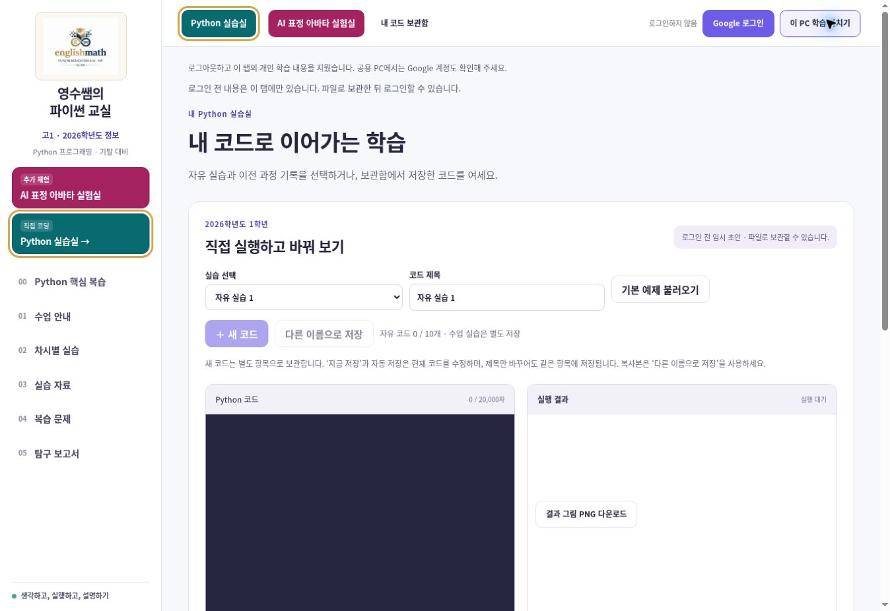
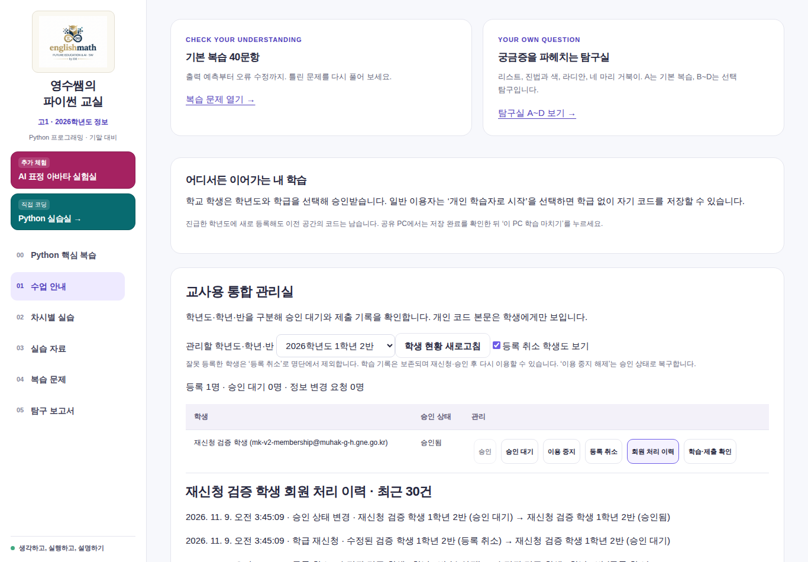
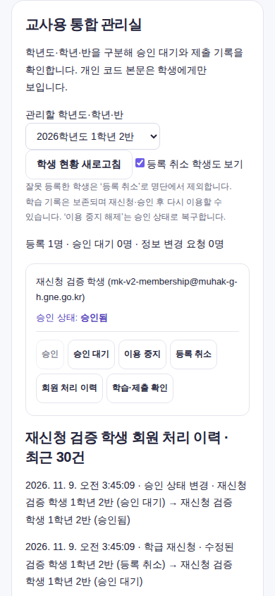
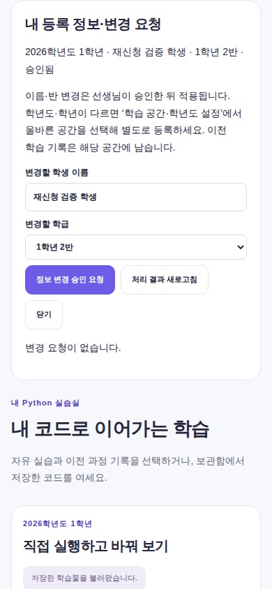

# MK 회원 관리 변경 — 운영 배포 완료

대상: [MK 파이썬 교실](https://mk.englishmath.kr/?page=practice) / Vercel `englishmath-python-mk`.

**2026-11-09 13:28 KST 운영 배포 완료.** 실제 도메인의 `mk-build-info.json` 응답(HTTP 200)과 브라우저 버전 표시가 최종 소스 `69920d5`와 일치합니다.

- 운영 배포: `dpl_9g5k8dBH2S7fFJRuVz2iALUMffid` / **READY** / 버전 **3.2.0**.
- 공개 빌드 정보: [mk-build-info.json](https://mk.englishmath.kr/mk-build-info.json).
- 승인한 공유 Firebase 규칙 확장도 게시 후 콘솔을 다시 읽어 전체 내용과 해시 일치를 확인했습니다.
- 실제 학교 교사 Google 로그인, 회원 8명 조회, 신규 등록 취소 버튼, 회원 처리 이력 조회 및 학습 종료 후 명단·이력 제거를 확인했습니다.
- 실제 학생의 승인 상태·학습 데이터는 시험 목적으로 변경하지 않았습니다. 실제 학생의 요청→교사 승인 운영 쓰기 시험, 학교 PC·실물 카메라는 **NOT_RUN**입니다.

기준 소스: `61840168f9213a1e7b9e4198b60fdfb3a04d6620` (여러 코드 저장 수정 포함).
작업 브랜치: `work/mk-member-management-20261109`.

## 학생과 교사의 사용 방법

1. 학생: Google 로그인 후 **내 등록 정보·변경 요청**에서 이름과 반을 입력하고 **정보 변경 승인 요청**을 누릅니다. 승인 전에는 기존 이름·반·승인 상태를 유지합니다.
2. 교사: **교사용 관리실**에서 현재 등록 학급을 선택하고 **학생 현황 새로고침**을 누릅니다. 학생 행에 변경 전후 정보가 표시됩니다. **정보 변경 승인** 또는 **정보 변경 반려**를 선택합니다. 반려 시 학생에게 보일 사유를 입력합니다.
3. 반 변경을 승인하면 학생이 새 반 명단으로 이동합니다. 학생의 기존 학급 승인 상태는 유지됩니다. 승인 대기 학생은 정보 변경 승인과 별개로 학급 **승인**이 필요합니다. 기존 제출본은 제출 당시 반 정보로 보존되며, 새 반으로 다시 제출할 때 새 반 정보가 적용됩니다.
4. 잘못 등록한 학생: **등록 취소** → 확인. 기본 명단에서 제외되며 코드·복습·보고서·제출 기록은 보존됩니다. Google 계정 또는 학습 기록을 영구 삭제하는 기능은 아닙니다.
5. 취소 복구: **등록 취소 학생도 보기** → **등록 복구 · 승인 대기** → 내용 확인 후 **승인**. 학생 본인도 취소 상태에서 이름·반을 고쳐 **학급 재신청**할 수 있습니다. 재신청은 자동 승인되지 않습니다.
6. 정지 해제: 이용 중지 학생의 **이용 중지 해제** → 확인. 승인 상태로 복구됩니다. 이용 중지 학생은 재신청으로 정지를 우회할 수 없습니다.
7. **회원 처리 이력**에서 최근 30건의 요청·승인·반려·취소·복구를 확인합니다. 서버 이력은 수정·삭제가 금지됩니다. 구버전 화면의 기존 상태 변경은 호환성을 위해 유지되므로 새 기능 적용 전 이력이 소급 생성되지는 않습니다.
8. 학생은 **처리 결과 새로고침**으로 결과를 확인합니다. 다른 학년도·학년은 **학습 공간·학년도 설정**에서 별도로 등록하며 이전 공간의 기록은 그대로 남습니다.

## 데이터와 권한 범위

- Firebase 프로젝트: `englishmath-python-classroom`.
- 현재 게시 규칙을 Firebase Console에서 전체 복사해 기준 파일과 SHA-256 일치를 확인했습니다.
- 기준: `mk/security/production-20261109.rules`
  SHA-256: `dda6ec21249d899fbcca4d1d71905b411b493821c7769edb2fdd724c956c8eb5`.
- 게시 완료 규칙 SHA-256: `68441c8d2197ac98c8550ffa2a4cdc283560c1426e6be61e48ed4f1c41f54d30`.
- 게시 파일: `mk/security/membership-proposed.rules`. 기존 규칙 0줄 삭제, MK 회원 처리 규칙 74줄 추가. 게시 시각은 2026-11-09 13:24 KST이며, 게시 직전 기준 해시 확인과 게시 후 서버 재조회 비교를 모두 통과했습니다.
- 변경 경로: `cohorts/2026/grade1_users/{uid}` 및 기존 2027 학년별 회원 경로, 각 회원 아래 `membershipHistory/{version}`.
- 학생은 본인의 이름·반 변경을 요청하거나 철회하고, 취소된 등록만 승인 대기로 재신청할 수 있습니다.
- 기존 학교 교사 계정 + 기존 `staff` 권한 확인을 거쳐 교사만 정보 변경 승인·반려, 등록 취소·복구, 승인 상태 변경을 할 수 있습니다.
- 모든 새 처리에서 회원 버전, 서버 타임스탬프, 기존 정보가 일치해야 합니다. 회원 변경과 이력 생성은 하나의 서버 트랜잭션으로 처리합니다.
- SW `users/{uid}`, `staff`, `config`, 개인 `public_users`, 기존 코드 저장 제한·수업 콘텐츠·상용 Python 배포는 변경하지 않습니다.
- 실제 운영 학생의 승인 상태 또는 학습 데이터는 시험 목적으로 바꾸지 않았습니다.

## 완료한 운영 적용 순서

1. 제안 규칙을 사용하는 에뮬레이터 권한 검사, 저장 회귀, 브라우저 및 모바일 검사 통과.
2. 정확한 소스 SHA로 MK 미리보기 빌드 확인.
3. 공유 Firebase 규칙의 제한된 확장에 대한 운영 적용 승인.
4. 게시 직전 운영 규칙을 다시 읽어 기준 해시와 비교. 다르면 그 변경을 보존해 재검토.
5. 검증한 제안 규칙 게시 후 MK 프로젝트만 운영 배포.
6. MK 배포 SHA·공개 화면 확인. SW와 상용 Python 배포가 동일함을 확인.

## 확인된 결과

- 단위 검사 41개, 보안 검사 44개, 통합 브라우저 10개 시나리오, 기존 수업 실행·키보드·PC/모바일 브라우저 검사 모두 PASS.
- 모바일에서는 학생별 카드로 이름·승인 상태·처리 버튼을 표시합니다. 메뉴 전환 완료, 이름 표시 폭, 페이지 넘침을 검사하고 에뮬레이터 증거 사진을 수집했습니다.

- 최종 소스: `69920d59398a9635d8f6f3f572a4434b6ae5a8b6`.
- 신규 회원 보안 검사 13개: PASS (Firebase Emulator).
- 기존 저장·학년 분리 보안 검사 31개: PASS (기존 기준 규칙 회귀).
- 제안 전체 규칙을 사용하는 브라우저 회원 관리 시나리오: PASS. 오프라인 요청 입력 보존, 요청→반려→재요청→승인, 정지→해제, 등록 취소→재신청→승인, 별도 Chromium 컨텍스트의 코드 복원, 학생·교사 390px 화면, 로그아웃 시 반려 사유·명단 제거 검사 포함.
- 자동화된 회원 변경 시나리오는 Auth Emulator의 Google 로그인 화면과 Firestore Emulator를 사용했습니다. 별도로 운영 사이트의 실제 교사 Google 로그인·회원 목록·이력 조회·학습 종료를 확인했습니다. 독립 브라우저 컨텍스트 검증은 실제 학교 PC 검사가 아닙니다.
- 운영 배포 후 비교: MK만 `dpl_9g5k8dBH2S7fFJRuVz2iALUMffid` / `69920d5`로 변경. SW 게시 `912dffc`, 상용 Python `dpl_2T6xocywVvCL7Jue3Lk4VBjsbGPR` / `0c9ecc0`, 공통 main `c38e7ce`는 기존과 동일합니다.
- 기능 구현 전체 CI: https://github.com/englishmath75/pico-lab-classroom/actions/runs/42556000024 **SUCCESS**.
- 모바일 명단 최종 수정본 CI: https://github.com/englishmath75/pico-lab-classroom/actions/runs/42557919548 **SUCCESS**. 단위 41개, 보안 44개, 통합 시나리오 10개 및 수업 실행·PC/모바일·키보드 검사 모두 통과했습니다.
- 최종 미리보기 배포: `dpl_7rMcCPZSMCS6tCkHsRVD9SFm6c8T`, **READY**. `mk-build-info.json`의 소스 SHA가 최종 커밋과 일치합니다.
- 미리보기 및 실제 운영 브라우저에서 실습 화면·여러 코드 저장 도구·버전 `69920d5` 표시 확인. 변경 처리의 쓰기 검증은 아래의 에뮬레이터 결과입니다.
- 미리보기 승격 API가 422를 반환하여 동일한 검증 SHA를 직접 운영 대상으로 빌드했습니다. 최종 운영 빌드는 성공했고 실제 MK 도메인 연결을 확인했습니다.

### 화면 증거 — 테스트 계정 / Firebase Emulator

운영 적용 상태: **DEPLOYED / READY**. 위 세 회원 관리 화면은 테스트 계정의 에뮬레이터 증거이며, 문서 상단 실습 화면은 실제 운영 사이트입니다. 실제 학생 명단은 공개 증거에 포함하지 않았습니다.
학교 PC 실기, 실제 학생 Google 계정의 신규 변경 요청·교사 승인, 실제 학교 카메라: 별도 확인 전까지 **NOT_RUN**.

## 복구

앱 문제 시 MK의 기존 운영 배포 `dpl_BqrBHCd6j4TDMunQBvAFkeUbKuH9` / 소스 `6184016`으로 복귀합니다.
규칙 문제 시 현재 게시 규칙과 게시 직전 백업을 비교하고, 이후의 SW 등 다른 변경을 보존하면서 이번 MK 추가분만 되돌립니다. 회원·이력·코드 문서를 삭제하지 않습니다.
취소·정지 상태는 별도 교사 승인 없이 자동 복구하지 않습니다.
