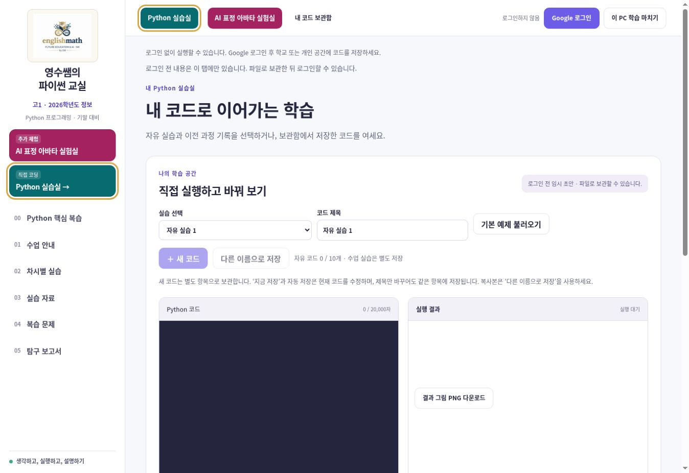
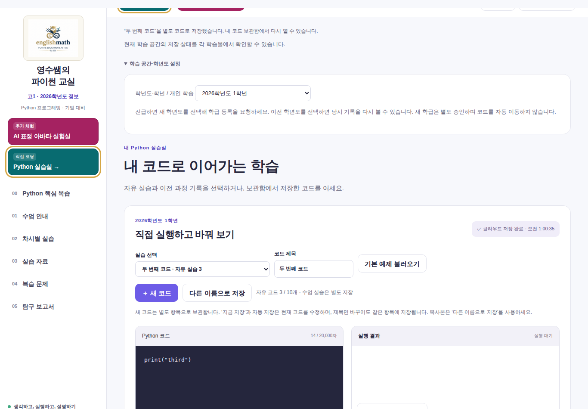
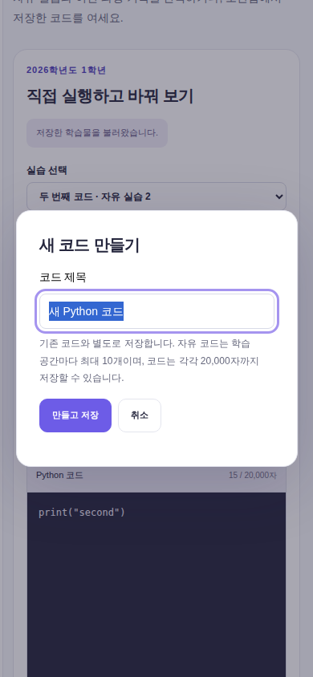

# MK 여러 코드 저장 수정 · 운영 배포 확인

- 운영 주소: https://mk.englishmath.kr/?page=practice
- 버전: 3.1.1
- 검증·배포 소스: `61840168f9213a1e7b9e4198b60fdfb3a04d6620`
- 작업 브랜치: `work/mk-multiple-codes-20261109`
- 이전 운영 소스: `7f1f2af6b5619779093408c4437f0b808d23d188`
- 운영 배포: `dpl_BqrBHCd6j4TDMunQBvAFkeUbKuH9` / READY / 2026-11-09T01:11:54.881Z
- 공개 도메인과 mk-build-info.json의 소스 SHA 일치, HTTP 200, 브라우저 새 버튼 및 버전 확인.

## 원인과 수정

기존 ‘지금 저장’은 선택한 workspace 하나를 수정합니다. 제목만 바꿔도 같은 항목에 저장되었고, 별도 코드를 만드는 버튼이 없었습니다.

- **＋ 새 코드**: 제목을 입력하여 빈 코드를 별도 항목으로 생성합니다.
- **다른 이름으로 저장**: 현재 코드를 별도 항목으로 복사합니다. 같은 제목도 다른 공간에 보관합니다.
- **지금 저장 / 자동 저장**: 현재 항목만 수정합니다.
- **실습 선택 / 내 코드 보관함**: 저장한 제목을 보고 해당 코드를 다시 엽니다.
- 기존 자유 코드 10개 슬롯을 사용합니다. 수업 활동 기록과는 별도입니다. 10개를 모두 사용하면 기존 코드를 덮어쓰지 않고 안내합니다. 필요한 코드를 내려받고 사용하지 않는 현재 저장본을 정리하면 다시 추가할 수 있습니다.
- 코드당 20,000자, 60초 자동 저장, 16초 쓰기 간격, 하루 150회, 최근 10개 수정 이력은 기존 제한 그대로입니다.
- 서버 목록·현재 계정의 초안을 확인해 빈 슬롯을 찾고, 트랜잭션 버전 조건으로 동시 생성 충돌을 차단합니다. 저장 실패 시 초안은 유지합니다.
- 계정·학년도 전환 시 이전 계정 제목 및 초안은 제거합니다. 교사 제출과 개인 저장은 기존대로 구분합니다.

## 실제 검증

[전체 검사 실행](https://github.com/englishmath75/pico-lab-classroom/actions/runs/42542881751) — SUCCESS

| 검사 | 결과 | 환경 / 증거 |
|---|---|---|
| 빌드·기존 수업 콘텐츠 / 40개 모델 답안 | PASS | GitHub Actions, 기존 활동 53개 유지 |
| 저장 로직·기존 복습 로직 | PASS | 35개 단위 검사 |
| 기존 권한·학년 분리 | PASS | 로컬 Firebase 에뮬레이터 31개 검사 |
| 독립 코드 3개 저장·각각 수정·같은 제목 | PASS | 테스트 학생, 실제 에뮬레이터 트랜잭션 |
| 학습 종료 후 별도 브라우저 컨텍스트 복원 | PASS | 서로 다른 Chromium contexts, 실제 학교 PC 아님 |
| 오프라인·슬롯 10개 한도 보호 | PASS | 기존 서버 내용 불변 확인 |
| 자동 저장·학년도/학생 전환·충돌·종료 | PASS | 브라우저 시나리오 총 9개; results.json |
| 기존 Python 실행·반응형·키보드 | PASS | 기존 전체 브라우저 검사 |
| 미리보기 빌드 | PASS | dpl_FyRTtnSqCMqpJPed4APj4R3NbxR2 / 동일 소스 |
| 운영 도메인 배포·새 UI·버전 | PASS | 공개 주소 직접 확인; live-production.jpg |
| 실제 Google 학생 계정으로 새 기능 저장·복원 | NOT_RUN | 현재 공유 브라우저에는 교사 계정만 로그인 가능; 학생으로 가장하거나 승인 상태를 바꾸지 않음 |
| 실제 학교 PC·학생 휴대폰·물리 카메라 | NOT_RUN | 브라우저 화면 크기 및 모의 카메라 검사를 실제 장치 검사로 보고하지 않음 |

전체 검사 아티팩트: `13642487323`, SHA-256 `13b5fb6d5774ea041dcd3e6544fc0b8a46016e37090832fd17e8dec0dc42ac59`.
학교 교사 Google 계정 로그인은 배포 전 운영 버전에서 확인했으며, 학생 저장 성공으로 계산하지 않았습니다.
운영 확인 중 관측된 콘솔 오류는 브라우저 확장 프로그램의 metadata 메시지였고, 앱 출처 오류는 관측되지 않았습니다.

## 보호 대상

| 대상 | 결과 |
|---|---|
| SW 게시 저장소 main | 전후 동일: 912dffc2c619a0f94a4189140bb28926a0598b26 |
| 공용 소스 main | 변경 없음: c38e7ce5e057b68898d086dde1caaaceae4f6d00 |
| 상용 englishmath-python.vercel.app | 전후 동일: dpl_2T6xocywVvCL7Jue3Lk4VBjsbGPR / 0c9ecc02c9f631edd5da48dd0126aef640887629 |
| 공유 Firebase | 운영 규칙 및 학생·교사 데이터 변경 없음. 기존 규칙 스냅샷은 테스트에만 사용 |
| MK PR #39와 기존 작업 브랜치 | 병합·수정하지 않음. 해당 운영 소스에서 독립 브랜치로 수정 |
| 수업·아바타 | 기존 콘텐츠 유지; 아바타 저장 추가 없음 |

현재 운영 규칙 스냅샷 SHA-256:
`dda6ec21249d899fbcca4d1d71905b411b493821c7769edb2fdd724c956c8eb5`.
`mk/security/production-20261109.rules`는 테스트 전용이며 이 작업에서 규칙을 배포하지 않았습니다.

## 화면 증거

운영 공개 화면(로그아웃 상태이므로 저장 버튼 비활성화):

에뮬레이터 학생 계정의 서로 다른 코드 3개 저장:

390px 화면의 새 코드 입력:

