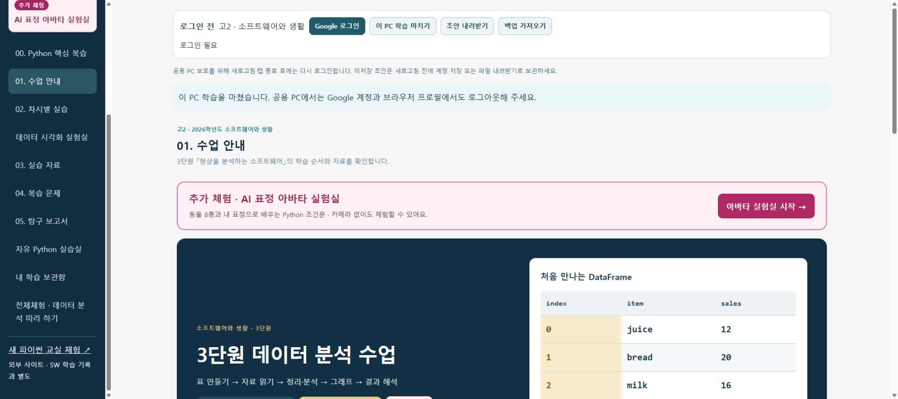
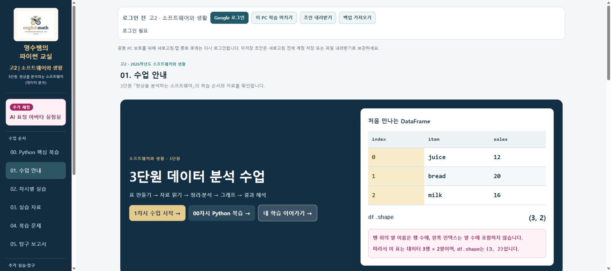
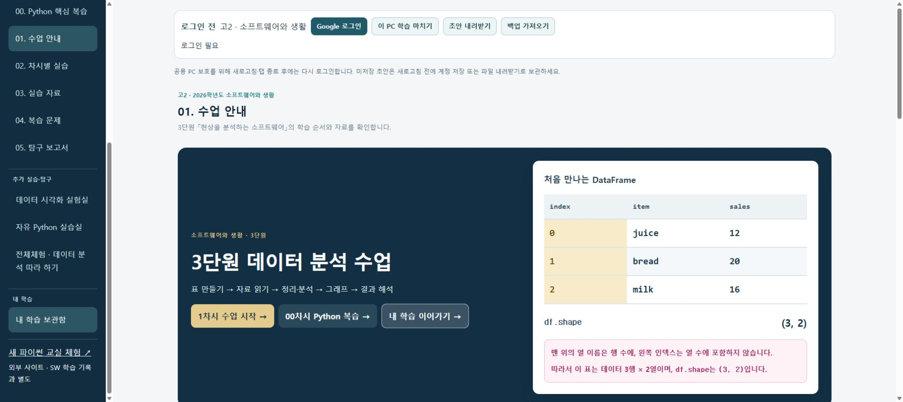

# SW V2 최종 검증표 — 운영 배포 및 메뉴·초기화면 정리
검증 소스: 7b47bc8e21de46576792ebbf754613d4a787c0e2.
게시 SHA: f226d1004c737fe50ed7b2460f6e77435b208211.
결과: **PASS 51 / BLOCKED 3 / NOT_RUN 4 / FAIL 0** (58개). 아래 환경별 실제 근거를 구분하며 모든 환경의 완벽한 무오류를 주장하지 않습니다.

- [최종 SW 전체 CI](https://github.com/englishmath75/pico-lab-classroom/actions/runs/42268100470): 성공.
- [SW 게시 후보 검사](https://github.com/englishmath75/sw/actions/runs/42269961510): 성공.
- [SW 운영 게시 실행](https://github.com/englishmath75/sw/actions/runs/42269964662): 성공.
- [공개 SW](https://sw.englishmath.kr/) · [공개 버전](https://sw.englishmath.kr/site-version.json).
- [운영 배포 증거](review-evidence/production-release-20261107.json) · [실계정 독립 복원](review-evidence/LIVE_ACCOUNT_VERIFICATION.md) · [보호 사이트 재조회](review-evidence/protected-deployments-final.json).
- [전체 메뉴·저장 범위](ACTIVITY_MAP.md) · [MK/SW 비교](COMPARISON.md) · [교사용 사용법](TEACHER_GUIDE.md) · [복구 절차](ROLLBACK.md).
- [규칙 적용 증거](security/production-applied-20261107.json). 승인된 공유 규칙은 2026-11-07 01:58 KST 적용 후 활성 원문과 대조했습니다. 이번 메뉴·홈 수정은 규칙을 변경하지 않았습니다.
- [구현 PR #40](https://github.com/englishmath75/pico-lab-classroom/pull/40)는 SW 전용 초안·미병합입니다. 공통 source main과 MK PR #39는 변경하지 않았습니다.

실계정 저장·종료·재로그인·독립 브라우저 복원은 바로 이전 운영 소스 af113f4 / 게시 747496d에서 검증했습니다. 최종 7b47bc8은 메뉴·홈·저장 안내 및 재로그인 안내 초기화를 수정했고 저장 코어와 승인된 공유 규칙은 동일합니다. 최종 소스에서도 전체 저장·규칙·브라우저 회귀를 다시 통과했습니다. 최종 운영 공개 화면·버전·Python 검사는 위 새 배포 실행과 별도 운영 증거에 기록했습니다.

| ID | 우선 | 요구 환경 | 항목 | 결과 | 실제 근거와 제한 |
|---|---|---|---|---|---|
| B01 | P0 | READ_ONLY | 운영 기준 식별 | PASS | 시작 시 source c38e7ce / publisher 1716210, MK·상용 배포 ID·SHA·alias와 Firebase 프로젝트를 직접 확인. COMPARISON.md 및 security/live-read-20261107.json. |
| B02 | P0 | STATIC | SW 콘텐츠 보존 | PASS | 콘텐츠 보존 검사: 10차시·50단계·20문항·7개 보고서 키·CSV 원본 해시·A~D·영상/실행 자산 유지. 추가 저장 안내 회귀 검사와 1,065개 내부 링크 검사 통과. |
| B03 | P0 | STATIC | MK 코드 보호 | PASS | SW 전용 PR #40. MK PR #39 미병합·기존 7f1f2af 유지, source main 미변경. MK 프로젝트 설정 쓰기 없음. |
| B04 | P0 | READ_ONLY | 운영 규칙 확보 | PASS | 학교 계정으로 활성 규칙 전체 31,905자·기존 SHA를 재확인한 뒤 승인된 확장안을 게시. 2026-11-07 01:58 KST 활성 버전 33,831자와 적용 SHA256 81db0ec1…eee1e 재대조 완료. security/production-applied-20261107.json. |
| B05 | P0 | STATIC | 활동/경로 목록 완성 | PASS | ACTIVITY_MAP.md와 registry/schema/models에 화면·별칭·입력·89개 고정 활동·종류별 복원 연결. 실행기 전용 문서는 학습 메뉴가 아닌 내부 자산. |
| N01 | P0 | LIVE | 공통 인증·내부 이동 | PASS | 실제 학교 Google 계정으로 home→차시→보고서→내부 시각화→복습→자유 실습→보관함 이동에서 같은 계정·기존 고2 학급 확인. 전체 경로는 에뮬레이터 브라우저 검사도 통과. |
| N02 | P0 | BROWSER | 옛 주소 직접 진입 | PASS | 게시 후보의 등록된 모든 화면, student-room panel/workspace, data-lab/index, 기존 pandas-data-lab 리다이렉트, 차시 7/8 직접 진입 확인. |
| N03 | P0 | BROWSER | 뒤로·앞으로·새로고침 | PASS | 브라우저 내부 이동·뒤로·새로고침 정책 시험, 보고서→복습→차시 복원 통과. 새로고침 후 재로그인이 필요한 정책을 화면에 표시. |
| N04 | P0 | BROWSER | 메뉴 연결 누락 없음 | PASS | 00~05 연속 메뉴와 추가 실습·탐구 / 내 학습 / 교사용 그룹, 분홍색 아바타를 구분. 홈의 수업 진행 경로·A~D와 내부 시각화, 외부 보조 링크를 검사. |
| N05 | P0 | BROWSER | 정적 자료 보존 | PASS | 실제 CSV/.py/JSON/TXT/PNG 다운로드와 경로 검사 통과. 원본 영상·자료 자산 존재 검사. 모든 영상 전체 재생을 주장하지 않음. |
| N06 | P0 | BROWSER | 읽기/체험 무저장 | PASS | 모든 등록 경로의 읽기 전용 저장 버튼 숨김 검사, 아바타 실제 DB 무쓰기 확인. 자료 페이지는 편집 CSV/자유 코드가 있어 혼합 저장 대상. |
| N07 | P1 | BROWSER | 접근성·반응형 | NOT_RUN | 390/1440/1920px·키보드·200% 텍스트 크기 시험 PASS, 후보 스크린샷 육안 확인. 실제 브라우저 200% 확대 조작은 NOT_RUN. |
| S01 | P0 | EMULATOR+LIVE | 차시 코드 저장 | PASS | 실제 학교 계정의 1차시 코드 저장 버전 1 확인, 별도 연결 Chrome에서 같은 코드 복원. 60초 자동 저장과 기존 plain code 형식은 에뮬레이터 회귀도 통과. |
| S02 | P0 | EMULATOR+LIVE | 단계별 학습물 | PASS | 실계정 예측·해석·stdin·미채점 확인 답을 저장하고 독립 브라우저에서 동일 값을 확인. 단계 위치·완료·채점 복원은 에뮬레이터 브라우저 검사로 검증. 모든 단계의 실계정 재실행을 주장하지 않음. |
| S03 | P0 | EMULATOR+LIVE | 복습·오답 | PASS | 실계정 미채점 선택 저장→종료·재로그인 복원, 채점 후 오답 기록·필터 저장 성공 표시 확인. 독립 브라우저에서 선택·0/20 채점·wrong 필터 복원. 다시 풀기는 에뮬레이터 검사. |
| S04 | P0 | EMULATOR+LIVE | 보고서 7개 항목 | PASS | 실제 학교 계정으로 보고서 7개 항목 작성·자동 저장·버전 1 확인. 종료·재로그인 및 독립 브라우저에서 7개 값을 모두 대조. |
| S05 | P0 | EMULATOR+LIVE | 보충·자유 실습 | BLOCKED | 실계정 자유 실습 scratch-02의 코드·제목을 독립 브라우저에서 복원. 보충 D·전체체험 등은 에뮬레이터/브라우저 검사 PASS이나 모든 보충 활동의 실계정 복원은 미실시. |
| S06 | P0 | EMULATOR | 같은 활동·다른 활동 | PASS | 유한 ID·별칭·종류별 라우팅 시험 및 별도 DataLab 차시 상태. 늦게 로드한 복습 기록을 이전 화면 캐시가 가리지 않는 회귀 시험 통과. |
| S07 | P0 | EMULATOR | 전역 저장 큐 | PASS | 16초 UID 단위 순차 큐·timeout 슬롯·기본값 무쓰기·변경 없을 때 무쓰기·150회 한도 규칙 시험. 실제 브라우저 다중 초안 종료 저장 확인. |
| S08 | P0 | EMULATOR | 저장 중 재입력 | PASS | 저장 중 새 편집이 기존 응답 뒤에도 dirty로 유지되는 제어된 비동기 시험 통과. |
| S09 | P0 | EMULATOR | 늦은 읽기·계정 변경 | PASS | 이전 UID 늦은 읽기/대기 쓰기 차단, 계정 세대 확인 시험. 별도 계정에서 앞 학생 기록 미노출. |
| S10 | P0 | EMULATOR | 읽기 실패 보호 | PASS | 읽기 실패/손상 JSON/미래 스키마의 원문 보존·쓰기 차단·수리 후 재읽기 시험. 편집 화면도 읽기 실패 시 열지 않음. |
| S11 | P0 | EMULATOR | 충돌·이력 | PASS | 버전 충돌·내 초안 보존·명시적 서버본 선택·비교 뒤 새 버전 발생 거부 시험. 브라우저 이력 1→새 버전 3 복원 확인. |
| S12 | P0 | EMULATOR | 오프라인·한도·길이 | PASS | 오프라인 브라우저 저장 실패와 초안 JSON 내보내기, 재연결 후 저장. 20,000자·일일 한도·권한 실패가 성공 표시로 바뀌지 않는 시험. |
| S13 | P0 | EMULATOR | 종류별 보관함 | PASS | 코드·상태·보고서·시각화 6개 항목 보관함 및 각 전용 화면의 서버 복원 확인. 모든 ID의 routeForActivity 계약 시험. |
| S14 | P0 | EMULATOR | 기존 로컬 자료 이관 | PASS | 소유자 불명 localStorage 시험 자료 미가져오기. 파일 미리보기·본인 확인·충돌 취소/수락·중복 무쓰기·원본 파일 유지 확인. |
| D01 | P0 | BROWSER+LIVE | DataLab 같은 사이트 | PASS | SW 동일 출처 내부 시각화를 실계정으로 열고 실제 Python (3,2), 전후 표 실행 확인. 외부 원본은 삭제·재배포하지 않았고 보조 링크로만 남김. |
| D02 | P0 | BROWSER | pandas 첫 예제 | PASS | 첫 예제 import pandas as pd 단독, StringIO 없음. 실제 Python shape (3,2)와 표 출력 확인. |
| D03 | P0 | BROWSER | 실제 표 시각화 | PASS | 실제 loc (2,2), iloc (1,2), 필터 (2,2), 정렬 [20,30,10], 전후 표와 이벤트 이동 확인. |
| D04 | P0 | EMULATOR+LIVE | 시각화 저장 복원 | PASS | 실제 학교 계정으로 SW01 코드·예측·학습 설명을 저장하고 독립 브라우저에서 같은 값을 확인. 제공 CSV/ID/버전/해시와 SW03/SW04 복원은 에뮬레이터 검사. |
| D05 | P0 | BROWSER | 사용자 CSV 경계 | PASS | 저장 코어에서 사용자 CSV 미전송·새 세션 재선택 확인. 최종 게시 CI에서 실제 파일 선택 대화상자·메뉴 왕복 메모리 유지·계정 백업 본문 제외와 user-file 표시까지 PASS. |
| D06 | P0 | BROWSER | Python 실행 회귀 | PASS | 실제 pandas/Matplotlib/input/한글 출력·한글 그래프/PNG 다운로드/무한 반복 중지/네트워크 차단/iframe 정리 확인. |
| D07 | P0 | STATIC+BROWSER | 교재 편집 권한 | PASS | 학생 DataLab에는 교재 게시 기능을 이식하지 않음. 원본 교재·상용 서비스는 읽기 전용 조사와 SW 사본만 사용. |
| P01 | P0 | EMULATOR+LIVE | 명시적 학습 종료 | PASS | 실계정 여러 활동의 서버 저장 버전 확인 후 학습 종료→로그인 전·개인 입력 화면 해제, 재로그인 복원 확인. 미저장·실패 종료 선택지는 에뮬레이터 검사. |
| P02 | P0 | EMULATOR | 유휴 보호 | PASS | 가상 시계 14분 경고·15분 종료 PASS. 최종 게시 CI에서 실제 에뮬레이터 로그인→오프라인 저장 실패→유휴 강제 종료→코드 DOM/로그인 정리·서버 무쓰기까지 추가 통과. 실제 학교 PC 시험 아님. |
| P03 | P0 | EMULATOR | 계정·공간 격리 | PASS | 에뮬레이터 A→B 비노출·이전 세대 응답 차단·MK 학년도/cohort/개인/legacy users 분리 회귀 통과. |
| P04 | P0 | BROWSER | 아바타 저장 없음 | PASS | 다른 초안이 없는 새 가상 계정으로 아바타 조작 전후 workspaces/progress/revisions/submissions/limits 동일·내용 쓰기 0 확인. 코드 재진입 폐기. |
| P05 | P0 | MOCK_MEDIA | 카메라 수명 | PASS | MOCK_MEDIA 명시 시작·중지·재시작·이탈 track 종료·재진입 비활성, 권한 거부·가상 모드·슬라이더 초기화 PASS. 물리 카메라 아님. |
| P06 | P0 | STATIC+BROWSER | 인증/얼굴 유출 없음 | PASS | 실행기에 인증/학생 프로필 전달 없음, 불투명 iframe/worker CSP·고정 자산 브로커·제한 다운로드 코드 검토 및 Python 네트워크 차단 실행. 실제 얼굴 영상은 수집하지 않음. |
| R01 | P0 | EMULATOR | 승인 상태 | PASS | 전체 규칙 에뮬레이터 미로그인/pending/blocked/approved 및 기존 승인 경계 회귀 통과. |
| R02 | P0 | EMULATOR | 학생 A/B 보안 | PASS | 직접 UID·잘못된 ID/필드/버전/quota 거부, 신규 64개 ID의 A 저장·B/교사 개인 본문 거부 확인. |
| R03 | P0 | EMULATOR+LIVE | 저장과 교사 제출 | BLOCKED | 에뮬레이터 자동 저장과 명시 제출 분리, 담당 교사 제출본 읽기·개인 본문 거부 PASS. LIVE 교사 경계 미실시. |
| R04 | P0 | EMULATOR | 학년도·MK 회귀 | PASS | 확인한 전체 운영 규칙 기반 제안으로 MK legacy/cohort/학년도/개인 계약 회귀 통과. MK 영역 바이트 보존 검사. |
| R05 | P0 | REVIEW | 규칙 승인 | PASS | 사용자의 명시적 승인 후 최소 SW 64개 고정 ID 확장을 적용. 게시 직전 운영 원문 일치 및 게시 후 활성 규칙 전체 정확 일치 확인. MK/cohort/개인 영역 바이트 보존. 학생 문서·승인·staff는 수정하지 않음. |
| R06 | P0 | STATIC | 비밀/우회 없음 | PASS | 운영 자격 증명 추가 없음. Firebase 공개 클라이언트 설정과 비밀을 구분. 테스트는 demo 프로젝트+localhost만 사용, 운영 우회 없음. |
| C01 | P0 | LIVE_INDEPENDENT | 실계정 독립 복원 | PASS | cloud Chrome에서 작성·서버 저장 후 연결 Chrome에서 별도 학교 Google 로그인하여 보고서 7항목·차시 코드/예측/해석/stdin/답·시각화 코드/예측/설명·복습 채점/오답필터·자유 코드를 복원. 같은 Chrome 새 탭이나 쿠키 복사 아님. |
| C02 | P0 | LIVE | 실계정 종료/재로그인 | PASS | 운영 통합판에서 학교 Google 계정 작성·자동 저장·보관함 버전 확인·학습 종료·재로그인·보고서 및 미채점 답 복원. 두 브라우저 모두 마지막 종료 확인. |
| C03 | P1 | LIVE_STUDENT_B | 실제 두 번째 학생 | BLOCKED | 허가된 실제 학생 B 계정으로 운영 시험을 하지 않음. 가상 학생 B 시험만 PASS이며 교사 계정으로 대체하지 않음. |
| C04 | P1 | SCHOOL_REAL | 학교 PC 2대 | NOT_RUN | 학교망 PC 2대에 대한 현장 접근 없음. |
| C05 | P1 | CAMERA_REAL | 실제 카메라 | NOT_RUN | 물리 카메라·실제 얼굴 표정 검증 없음. 가상 영상 시험만 별도 PASS. |
| C06 | P1 | LOAD_SIMULATION | 29계정 동시 접근 | PASS | 가상 29계정 초기 프로필/기록 읽기·동시 저장·옆 UID 접근 거부 975ms (최종 소스 CI). 브라우저/CDN 29개 동시 다운로드나 물리 29PC 시험은 아님. |
| C07 | P1 | SCHOOL_REAL | 학교 29PC 확대 | NOT_RUN | 학교 29PC 현장 확대를 하지 않음. 먼저 실제 PC 2대 시험이 필요. |
| X01 | P0 | CI | 빌드·패키징 | PASS | 최종 소스 SW 전체 CI에서 저장/라우팅 19개, 공유 규칙 35개, 콘텐츠 3개, 실제 브라우저 11개 시나리오와 패키지/링크 검사 통과. 홈·메뉴·390px/1440px 배치 및 종료 안내 회귀 포함. |
| X02 | P0 | CI | 검증 SHA 게시 | PASS | 최종 source/publisher SHA를 고정한 기존 GitHub Pages 게시 성공. 두 초기 게시 시도 시간 초과는 해결 이력으로 보존하며 새 성공 실행으로 최종 판정. |
| X03 | P0 | LIVE | 공개 사이트 반영 | PASS | 공개 site-version의 source/publisher SHA 일치, 실제 공개 홈·그룹 메뉴·수업 정체성·Python·아바타/모바일 검사 확인. 후보 화면을 운영 증거로 대체하지 않음. |
| X04 | P0 | READ_ONLY | MK 무변경 | PASS | SW 게시 후 MK·상용 공개 자산 해시 및 운영 배포 ID/SHA 동일 확인. source main c38e7ce, MK PR39 미병합·7f1f2af 유지. MK의 기존 보류 상태는 그대로. |
| X05 | P0 | STAGING+REVIEW | 복구 재현 | PASS | 정상 source c38e7ce + publisher 1716210 재빌드/자료/브랜드 검사 통과. source 고정·예약 재배포 방지·기록 보존 복구 절차와 산출물 확보. |
| X06 | P0 | REVIEW | 최종 증거·비교표 | PASS | 58개 실제 결과·환경·제한, 정확한 소스/게시 SHA·CI/배포 링크·공개 화면·실계정 독립 복원 증거·메뉴/저장 범위·MK/SW 비교·교사용 사용법을 기록. |

## 실제 화면
아래는 운영 주소에서 직접 캡처한 화면입니다. CI 후보 이미지와 구분합니다.

## 해결 이력과 남은 검증
두 초기 Pages 게시 실행(42258241759, 42260562710)은 10분 제한으로 실패했습니다. 동일 Pages API의 제한 있는 큐 대기로 수정한 42262783452는 성공했고, 최종 메뉴·홈 수정본은 42269964662로 게시했습니다.
중간 소스 1a6637b의 메뉴 이름 변경은 기존 게시 검사 계약을 통과하지 못해 7b47bc8에서 '전체체험'을 보존하도록 수정했습니다. 해당 중간 소스는 운영에 배포하지 않았습니다.

BLOCKED: S05 보충 활동 전체 실계정 복원, R03 실제 학생→교사 제출 경계, C03 실제 학생 B.
NOT_RUN: N07 실제 브라우저 200% 확대 조작, C04 학교 PC 2대, C05 물리 카메라, C07 학교 29PC. 200% 텍스트 확대·가상 카메라·가상 29계정은 별도 검사로만 기록했습니다.
MK의 기존 보류 항목은 이번 SW 결과로 완료 처리하지 않았습니다.
