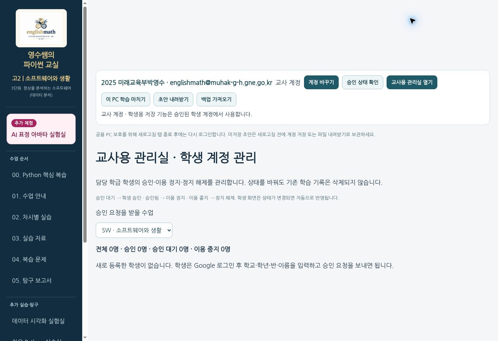

# SW 학생 등록 운영 배포 완료 — 2026-11-09

운영 URL: https://sw.englishmath.kr/?page=home

학생은 Google 학교 계정으로 로그인한 뒤 학교·학년·반·실제 이름을 직접 입력하여 선생님에게 승인 요청합니다. 승인 후 계정 저장을 사용할 수 있습니다. Google 표시 이름이나 이전 테스트 학급으로 학생의 학적을 추정하지 않습니다.

## 실제 배포
- 소스 SHA: `98c678d544497827bfc05212ea975614b6ba1d31`
- 게시 SHA: `912dffc2c619a0f94a4189140bb28926a0598b26`
- Pages 게시 성공: 2026-11-09 09:04 KST
- 운영 검사 완료: 2026-11-09 09:06 KST
- [배포와 운영 검사](https://github.com/englishmath75/sw/actions/runs/42538028938)
- [전체 통합 검사: 실제 Python 예제 183개 성공](https://github.com/englishmath75/pico-lab-classroom/actions/runs/42536561532)
- [가입·승인 전용 검사](https://github.com/englishmath75/pico-lab-classroom/actions/runs/42534945069)
- [공개 버전 정보](https://sw.englishmath.kr/site-version.json)

## 교사용 사용 방법
1. 학생: SW에서 Google 학교 계정으로 로그인합니다.
2. 학생: 학교를 선택하고 실제 학년·반·이름을 입력한 뒤 확인 체크와 **선생님께 승인 요청**을 누릅니다.
3. 선생님: 기존 학교 교사 계정으로 로그인 → **교사용 관리실 열기** → 학생의 학교·학년·반·이름 확인 → **학생 승인**.
4. 학생은 승인 상태가 갱신되면 계정 저장을 사용합니다. 승인 대기 중에는 **신청 정보 수정**으로 입력 실수를 고칠 수 있습니다.
5. 관리실의 **이용 정지 / 정지 해제**로 이용 상태를 관리합니다. 상태 변경으로 학습 기록이 삭제되지는 않습니다.

기존 테스트 승인은 승계하지 않습니다. 소속 정보가 없는 기존 계정은 재등록과 새 교사 승인이 필요합니다. 실제 운영 교사 계정으로 새 명단이 0명인 상태를 확인했습니다. 기존 학습 기록을 일괄 삭제하거나 교사 권한을 변경하지 않았습니다.

## 사이트 비교
| 대상 | 이번 변경 | 확인 |
|---|---|---|
| SW | 필수 학생 등록·새 승인 흐름·테스트 승인 승계 차단 | Pages 게시 및 공개 버전·교사 로그인·운영 실행 검사 PASS |
| MK | 변경 없음 | 운영 공개 JS/CSS SHA-256 동일, MK 보안 규칙 원문 보존 |
| 상용 파이썬 교실 | 변경 없음 | 운영 공개 JS/CSS SHA-256 동일 |

## 보안 규칙
게시 직전 운영 전체 규칙을 콘솔에서 복사하여 SHA-256을 대조했습니다. 기존 운영 규칙 `d3e9eef2efbb38a244f0f8030c3e8834c77b6dd27e8bc08946b975dafec68821`와 정확히 일치함을 확인한 뒤 SW 학생 등록 부분만 변경했습니다.

새 운영 규칙 SHA-256: `dda6ec21249d899fbcca4d1d71905b411b493821c7769edb2fdd724c956c8eb5`.
`config/swEnrollment`를 추가했습니다. `staff`, `config/access`, MK/cohorts/public_users 규칙은 유지했습니다. 게시 후 콘솔의 활성 버전과 전체 내용 해시를 다시 확인했습니다.

## 검증 범위와 한계
- PASS: 필수 입력, 1학년 학적, 승인 대기·교사 승인·정지 해제, 테스트 승인 무효화, 계정 전환, 별도 Chromium 컨텍스트 복원 — 에뮬레이터/브라우저 테스트.
- PASS: 운영 SW 실제 학교 교사 Google 로그인, 교사용 새 명단 0명, 기존 교사 권한.
- PASS: 운영 공개 홈페이지·메뉴·내부 데이터 시각화 실제 Python·터틀·한글 Matplotlib·90프레임 작품·분홍 아바타·영상 3종 재생.
- NOT_RUN: 실제 학생 Google 계정의 최초 등록→교사 승인→클라우드 저장 및 독립 브라우저 앱에서의 복원.
- NOT_RUN: 실제 학교 PC와 물리 카메라.
- 과거 MK 보류 검증 항목은 변경하지 않았습니다.

