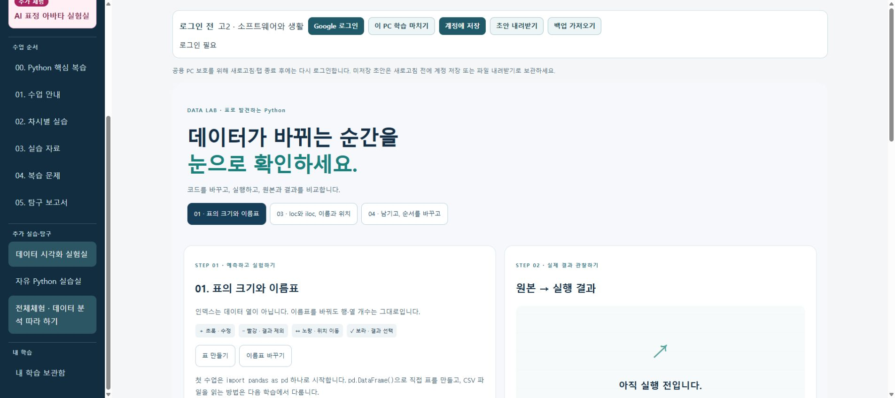

# SW 외부 체험 링크 삭제 — 운영 반영 완료

2026-11-07 04:46 KST, 사용자 최신 지시에 따라 공통 목차의 **새 파이썬 교실 체험 ↗** 링크와 **외부 사이트 · SW 학습 기록과 별도** 안내를 삭제했습니다. 이전 V2 문서의 보조 링크 유지 조건은 이 변경에 한해 대체됩니다.

- SW 내부 데이터 시각화 실험실: [그대로 사용](https://sw.englishmath.kr/?page=data-lab&unit=SW01)
- 별도 상용 사이트와 MK 배포, Firebase 규칙, 로그인·저장 코어 및 기존 수업 내용: 변경 없음
- 공통 shell과 사용하지 않는 외부 링크 CSS를 정리하고, 기존 콘텐츠·브라우저·게시·아바타 목차 검사를 새 구성에 맞게 갱신했습니다.
- 보존된 과거 버전을 재현하는 rollback 경로는 유지합니다.

## 확인 결과

- 연결 Chrome의 실제 운영 화면: 외부 링크 0개, 외부 안내 없음, 외부 영역 0개, 내부 실험실 링크 유지.
- 전체 소스 CI: core/store/route 19, 규칙 35, 콘텐츠 4, 브라우저 시나리오 12 및 내부 링크 1,029개 통과.
- 게시 후보의 모든 경로·다운로드·오프라인 종료 검사 통과.
- 운영 빌드·GitHub Pages 게시·보호 사이트 자산 비교 통과.
- 배포 후 익명 Chromium: 실제 Python 표 (3, 2), 수업 메뉴, 아바타 초기 카메라 비활성/저장 없음 확인.
- 이번 변경에서 Google 실계정·실제 학교 PC·물리 카메라 재검사는 하지 않았습니다. 기존 보류 항목을 완료로 바꾸지 않았습니다.

초기 검사에서 과거 외부 링크 필수 조건을 발견해 게시 검사 기준도 함께 수정했습니다. 이후 검사 서버의 글꼴 패키지 다운로드 지연으로 한 차례 취소 후 동일 소스의 validate 작업을 새 서버에서 재실행했고, 최종 성공을 확인한 뒤 게시했습니다.

## 배포 증거

- 소스: 03889ab04520ad2beea3d21d6080dc133536f396
- 게시: b1d44df6f1e6efb0c6af8e946f82d90b051b3393
- [전체 소스 검사 — 성공, 2차 시도](https://github.com/englishmath75/pico-lab-classroom/actions/runs/42279096871)
- [게시 후보 검사 — 성공](https://github.com/englishmath75/sw/actions/runs/42281779339)
- [운영 배포 및 공개 검사 — 성공](https://github.com/englishmath75/sw/actions/runs/42281782656)
- [운영 검사 산출물](https://github.com/englishmath75/sw/actions/runs/42281782656/artifacts/13535877430)
- [구조화 기록](external-link-removal-20261107.json)

