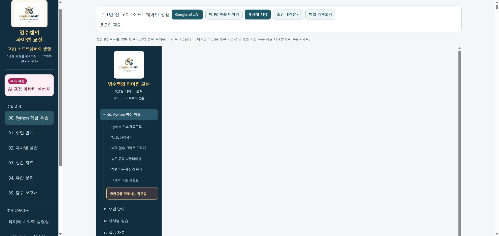
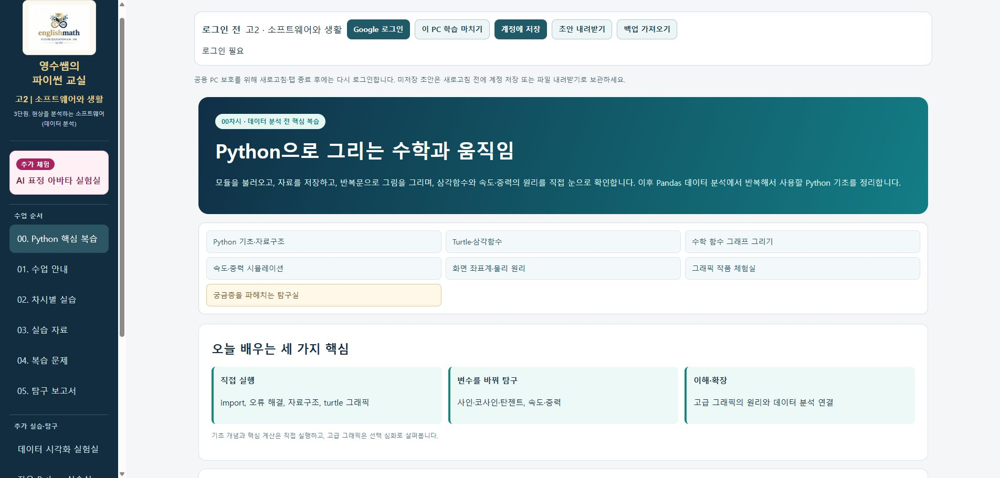

# 00. Python 핵심 복습 — 운영 화면 오류 수정 완료

2026-11-07 03:52 KST 기준, 수정본을 기존 [SW 운영 주소](https://sw.englishmath.kr/?page=python-review)에 배포하고 공개 화면을 확인했습니다.

## 원인과 수정

사용자가 제공한 화면과 운영 재현에서 공통 SW 목차 안에 예전 curriculum 목차·로고가 다시 표시되었습니다. 자동 높이 iframe 안에 100vh sticky sidebar가 남아 높이가 계속 증가했고, 본문 시작 위치가 100,000px까지 밀렸습니다. 기존 경로 열림 검사만으로는 이 시각적 오류를 잡지 못했습니다.

SW 빌드 변환에서 Python 핵심 복습·수학 함수 그래프·물리 원리·그래픽 작품 체험실 네 문서의 예전 전체 사이트 목차와 해당 sidebar 스타일을 제거했습니다. 기존 7개 하위 링크는 본문 상단의 반응형 주제 메뉴로 옮겼습니다. 원본 교육 문서·예제 코드·12개 복습 문항·시각화·자료는 보존했습니다.

수정 파일은 sw/legacy-transform.mjs, sw/src/legacy.css, sw/tests/content.test.mjs, sw/tests/browser.mjs 네 개입니다. 로그인·계정 저장 코어, Firebase 규칙, 다른 SW 메뉴·홈, MK·상용 Python 배포는 수정하지 않았습니다.

## 실제 검증

| 검사 | 환경 | 결과 |
|---|---|---|
| 네 문서의 모든 pre 코드 블록 원문 일치, 7개 주제 링크 보존 | 빌드 콘텐츠 검사 | PASS |
| 1440px / 390px 본문 시작·가로 넘침·높이 안정성 | CI Chromium | PASS |
| Turtle·물리 앵커, 하위 세 페이지 왕복 | CI Chromium | PASS |
| 00차시 12문항 채점·저장·종료·별도 브라우저 컨텍스트 복원 | Firebase Auth/Firestore 에뮬레이터 | PASS |
| 전체 회귀: core/store/route 19, 공유 규칙 35, 콘텐츠 4, 브라우저 시나리오 12 | CI | PASS |
| 내부 링크 1,029개·영상/자료·패키징 | 게시 후보 검사 | PASS |
| 운영 공개 Python 표 실행, 공통 메뉴, 아바타 초기 비활성/저장 없음 | 운영 익명 Chromium | PASS |
| 실제 운영 00차시 화면, 중복 목차 없음, 본문 시작 0px, 주제 7개 | 연결 Chrome 익명 | PASS |
| 운영 수학 함수 그래프·물리 원리·그래픽 작품 페이지 연결 | 연결 Chrome, 수학 마우스 클릭 / 하위 링크 키보드 활성화 | PASS |
| MK·상용 사이트 공개 자산 기준값 대조 | 운영 배포 후 보호 검사 | PASS |
| 이번 수정 SHA에서 Google 실계정 저장 재실행 | 실제 Google | NOT_RUN |
| 학교 PC·물리 카메라 | 학교 현장 | NOT_RUN |

1,065개였던 링크 수에서 제거된 36개는 네 문서에 중복 삽입된 전체 사이트 목차·로고·스타일 참조입니다. 원본 학습 내용은 콘텐츠 보존 검사로 확인했습니다.

실계정 저장·종료·독립 브라우저 복원은 이전 통합 운영판에서 수행한 증거를 그대로 구분해 유지합니다. 이번 복습 저장 검사는 에뮬레이터이며 실제 Google 검증으로 계산하지 않습니다. 기존 58개 표의 51 PASS / 3 BLOCKED / 4 NOT_RUN 상태 및 MK 보류 항목은 변경하지 않았습니다.

## 정확한 배포 증거

- 소스: [71481bc0abc7dbaf015987abdf45611b18a1ad78](https://github.com/englishmath75/pico-lab-classroom/commit/71481bc0abc7dbaf015987abdf45611b18a1ad78)
- 게시: [3a9fd1f4e422feefb2f1a65dfde9ef1a5ad9d941](https://github.com/englishmath75/sw/commit/3a9fd1f4e422feefb2f1a65dfde9ef1a5ad9d941)
- [전체 소스 검사 42272230384](https://github.com/englishmath75/pico-lab-classroom/actions/runs/42272230384): SUCCESS
- [게시 후보 검사 42273569495](https://github.com/englishmath75/sw/actions/runs/42273569495): SUCCESS
- [운영 빌드·Pages 배포·공개 검증 42273574240](https://github.com/englishmath75/sw/actions/runs/42273574240): SUCCESS
- [공개 검증 산출물](https://github.com/englishmath75/sw/actions/runs/42273574240/artifacts/13531333792)
- [구조화 검증 기록](python-review-fix-20261107.json)

## 운영 전후 화면

수정 전:

수정 후:

두 이미지는 실제 SW 운영 주소에서 캡처한 익명 화면입니다. 모바일 이미지는 CI 후보 검사 산출물이며 학교 PC 검증으로 표현하지 않습니다.
