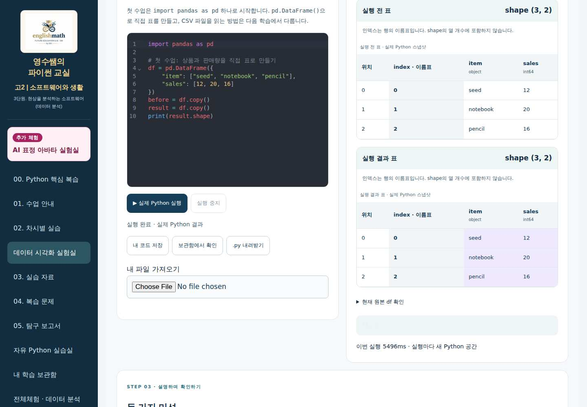
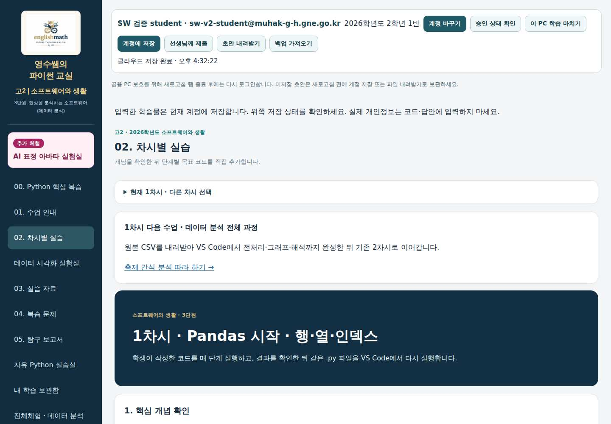
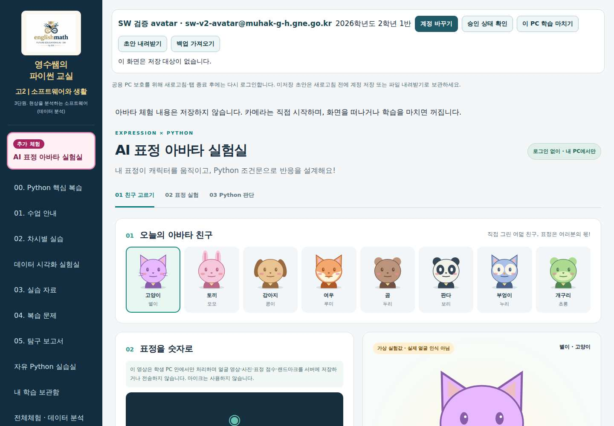
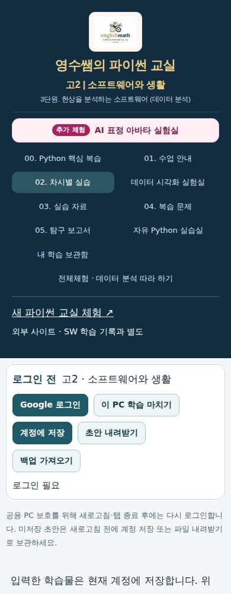

# SW V2 운영 적용 전 검토 상태
검증된 구현 source: af113f41e0f209f6f0aedd18596fad6788bd2609.
검증된 게시 후보: 8d7ac4e9f29505b6895bd3bdf1fd3d136fe7b170.
58개 결과: PASS 37 / BLOCKED 17 / NOT_RUN 4 / FAIL 0. 운영 완료 선언이 아닙니다.

- [소스 통합 CI](https://github.com/englishmath75/pico-lab-classroom/actions/runs/42252447686): 성공. 저장/라우팅 코어 19개, 전체 공유 규칙 회귀 35개(64개 신규 ID·가상 29계정 포함), 콘텐츠 보존 2개, 패키지 2개, 내부 링크 1,054개, 브라우저 통합 시나리오 11개.
- [최종 게시 후보 CI](https://github.com/englishmath75/sw/actions/runs/42255328515): 성공. 같은 소스 고정, 승인 없는 운영 게시 차단, 전체 등록 경로/별칭, 실제 다운로드, 사용자 CSV의 메모리 유지·백업 제외, 저장 실패와 겹친 15분 유휴 종료.
- 정상 SW source c38e7ce + publisher 1716210 복구 재빌드도 성공했습니다.
- 기존 source main/publisher main은 그대로이며 SW 운영에 게시하지 않았습니다. MK 운영 배포 dpl_2jP3XvaJbRS2cXUo4rqp2pB7yPUC / 7f1f2af, 상용 배포 dpl_2T6xocywVvCL7Jue3Lk4VBjsbGPR / 0c9ecc0도 재조회 결과 동일합니다. PR #39는 미병합 초안입니다.

[58개 검증표](../ACCEPTANCE_RESULTS.md) · [메뉴와 저장 범위](../ACTIVITY_MAP.md) · [MK/SW 비교](../COMPARISON.md) · [교사용 사용법](../TEACHER_GUIDE.md) · [규칙 변경 검토](../security/APPROVAL_REVIEW.md) · [복구 절차](../ROLLBACK.md)

## 후보 화면
아래는 가상 계정·가상 카메라로 테스트한 후보 화면입니다. 운영 화면·실제 학생·물리 카메라의 증거가 아닙니다.

## 필요한 운영 승인 및 남은 검증
공유 Firebase 전체 활성 규칙 31,905자를 학교 계정으로 직접 확인했고 제안 33,831자를 준비했습니다. 기존 SW 고정 25개 활동에 고정 64개 ID를 추가하는 함수와 SW 검사 5곳만 변경합니다. MK/cohort/개인 영역과 학생 승인·교사 권한·제출 경계를 보존합니다. 학생 자료를 수정하거나 삭제하지 않습니다.

운영 규칙 적용은 아직 승인받지 않았으며 게시하지 않았습니다. 승인 후 현재 활성 규칙 전체를 다시 읽어 확인한 뒤 제안을 적용하고, 검증된 SW 조합을 기존 GitHub Pages로 게시합니다. 이후 공개 버전·화면·실계정 저장·종료·독립 브라우저 복원을 확인합니다.

학교 계정의 Firebase Console 로그인은 확인했습니다. 이후 Work 연결 브라우저가 끊겨 실제 화면 작업을 계속하려면 브라우저 재연결이 필요합니다. Google 비밀번호를 요청하거나 저장하지 않습니다.
실제 학생 B·학교 PC 2대/29대·물리 카메라·실제 브라우저 200% 확대는 별도 환경 검증으로 남겨 두었습니다. MK의 기존 보류 항목은 바꾸지 않았습니다.
