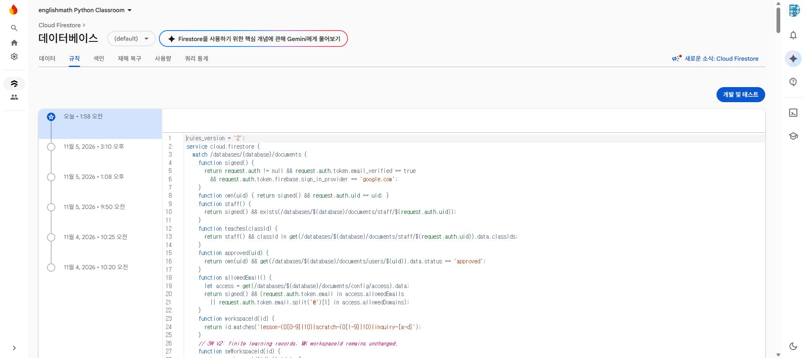
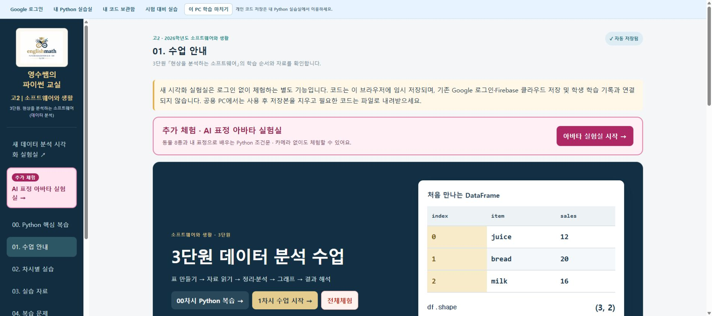

# SW V2 운영 배포 진행 상태

공유 규칙은 명시적 승인 후 운영에 적용했고 활성 원문을 재대조했습니다. 홈페이지 빌드/검증은 성공했지만 두 차례 Pages 게시가 시간 제한으로 실패했습니다. 수정된 배포 절차의 새 실행은 진행 중입니다.

정확한 58개 결과와 현재 실행·SHA는 [검증표](../ACCEPTANCE_RESULTS.md)를 따릅니다. 운영 배포 완료 선언이 아닙니다.

[규칙 적용 증거](../security/production-applied-20261107.json) · [메뉴·저장 범위](../ACTIVITY_MAP.md) · [비교표](../COMPARISON.md) · [교사용 사용법](../TEACHER_GUIDE.md)

기존 datalab-python-table/lesson-account-restored/avatar-common-menu/layout-390 이미지는 가상 계정으로 검증한 후보 화면입니다.
